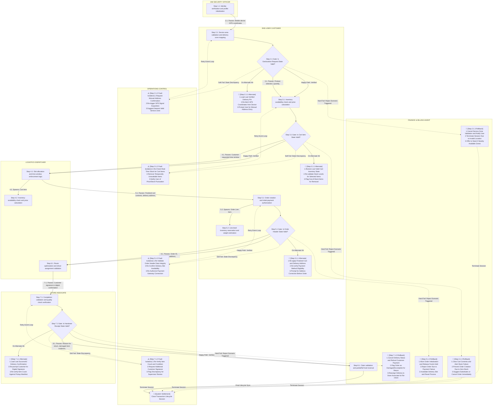

User:

You are an autonomous, expert, domain-agnostic Business Process Gap Auditor.

DOMAIN: Quick Commerce (Q-Commerce)
NICHE: Hyperlocal Grocery Delivery
BUSINESS OBJECTS: [{"object_name":"User Account","input":"Customer registration details and authentication credentials","activity":"Identity verification and profile initialization","output":"Authenticated session token and user context"},{"object_name":"Geolocation Request","input":"Mobile device GPS coordinates and address verification data","activity":"Service area validation and delivery zone mapping","output":"Confirmed delivery pin and applicable service fee"},{"object_name":"Cart Item","input":"Product selection, quantity, and selected delivery slot","activity":"Inventory availability check and price calculation","output":"Updated cart state with real-time stock confirmation"},{"object_name":"Order Header","input":"Finalized cart contents, delivery address, and payment method","activity":"Order creation and initial payment authorization","output":"Unique Order ID and confirmed order receipt"},{"object_name":"Order Line Item","input":"Detailed product specifications, SKU, and unit price per order header","activity":"Line-level inventory reservation and weight estimation","output":"Reserved stock hold and aggregated line subtotal"},{"object_name":"Delivery Slot","input":"Customer requested time window and driver availability data","activity":"Slot allocation and time-window enforcement logic","output":"Assigned pickup and delivery timestamps"},{"object_name":"Merchant Inventory Stock","input":"Real-time stock levels from local store database","activity":"Batch deduction and shelf-space allocation update","output":"Adjusted available quantity and stock status flags"},{"object_name":"Assigned Courier","input":"Order ID, delivery address, and courier availability status","activity":"Route optimization and driver assignment validation","output":"Active delivery task and assigned courier ID"},{"object_name":"Pickup Manifest","input":"List of items to collect and store location coordinates","activity":"Store associate task generation and item verification","output":"Collected items list and ready-for-pickup status"},{"object_name":"Handover Receipt","input":"Customer signature or digital confirmation and item count","activity":"Completion validation and quality check verification","output":"Delivered status update and final payment capture"},{"object_name":"Payment Transaction","input":"Order total, tax, fees, and selected payment gateway data","activity":"Secure fund transfer and receipt generation","output":"Paid status flag and digital invoice record"},{"object_name":"Refund Claim","input":"Reason for return, damaged item evidence, and original order ID","activity":"Claim validation and partial/full fund reversal","output":"Refund approval and adjusted account balance"},{"object_name":"Subscription Plan","input":"User eligibility and recurring payment authorization","activity":"Fee calculation and recurring billing cycle setup","output":"Active membership tier and priority delivery rights"},{"object_name":"Loyalty Points Ledger","input":"Purchase total and promotional offer codes","activity":"Point accrual calculation and redemption validation","output":"Updated points balance and discounted order total"},{"object_name":"Cancellation Request","input":"User cancellation reason and current order status","activity":"Inventory release and refund initiation logic","output":"Cancelled order status and released stock availability"}]
ACTOR / ROLE / RESPONSIBILITY / AUTHORISATION MATRIX: [{"actor_name":"End-User Customer","operational_role":"Hyperlocal shopper executing grocery acquisition lifecycle","core_responsibilities":["Registering identity and managing authentication credentials","Requesting geolocation for delivery zone validation","Selecting items, quantities, and delivery slots","Authorizing payments and managing loyalty points","Initiating cancellations or refund claims"],"access_authorization_and_scope":{"What_They_Can_See":["My User Account Profile","Available Delivery Slots","Real-time Cart State and Stock","Assigned Courier Details","Order History and Invoices"],"What_They_Can_Create":["New User Account","Cart Item","Order Header","Delivery Slot Request","Refund Claim"],"What_They_Can_Change":["User Profile Details","Cart Item Quantities and Selections","Delivery Address and Slot Preference","Payment Method Selection"],"What_They_Can_Remove":["Cart Items Pending Checkout","Active Delivery Slot Request"],"Operations_They_Can_Run":["Place Order","Cancel Order","Verify Handover Receipt","Redeem Loyalty Points"],"Business_Rules_And_Guardrails":{"Data_Privacy":"Personal PII and payment tokens encrypted; visible only to self and authorized support agents","Order_Lock":"Cannot modify Order Header or Order Line Items after Payment Transaction status is 'Authorized' or 'Captured'"}}},{"actor_name":"Store Associate","operational_role":"On-site inventory handler executing pickup and packing workflows","core_responsibilities":["Generating and managing Pickup Manifests","Verifying item counts and quality","Updating real-time stock levels","Confirming item readiness for courier"],"access_authorization_and_scope":{"What_They_Can_See":["Assigned Pickup Manifests","Current Merchant Inventory Stock","Store Location Coordinates","Pending Order Line Items for Store"],"What_They_Can_Create":["Pickup Manifest","Inventory Adjustment Records","Item Verification Log"],"What_They_Can_Change":["Merchant Inventory Stock Levels","Pickup Manifest Status (Pending -> Ready)","Item Status Flags (Damaged/Available)"],"What_They_Can_Remove":["Reserved Stock Hold upon Cancellation Request validation","Invalid Line Items from Manifest"],"Operations_They_Can_Run":["Initiate Stock Deduction","Complete Item Verification","Update Stock Status Flags"],"Business_Rules_And_Guardrails":{"Data_Privacy":"Access restricted to current store shift and assigned orders; cannot view customer PII beyond necessary contact info","Order_Lock":"Cannot modify Order Header financial details; can only adjust inventory reserves for active orders"}}},{"actor_name":"Logistics Dispatcher","operational_role":"Fleet manager optimizing courier assignments and route efficiency","core_responsibilities":["Validating courier availability status","Optimizing routes for assigned couriers","Managing delivery slot allocations","Monitoring active delivery tasks"],"access_authorization_and_scope":{"What_They_Can_See":["All Assigned Courier IDs and Status","Order Headers with Delivery Addresses","Real-time Driver Location Data","Global Delivery Slot Availability"],"What_They_Can_Create":["Assigned Courier Task","New Delivery Slot Allocation"],"What_They_Can_Change":["Courier Assignment Mapping","Delivery Slot Timestamps","Route Optimization Parameters"],"What_They_Can_Remove":["Inactive Courier Assignments","Over-allocated Delivery Slots"],"Operations_They_Can_Run":["Assign Courier to Order","Re-assign Courier upon deviation","Enforce Time-Window Constraints"],"Business_Rules_And_Guardrails":{"Data_Privacy":"Can view addresses and contact info; cannot view customer personal profile history","Order_Lock":"Cannot alter Order Header payment status; can only reassign logistics resources"}}},{"actor_name":"Merchant Inventory Manager","operational_role":"Store operations lead managing shelf-space and stock integrity","core_responsibilities":["Managing bulk stock deductions","Allocating shelf-space","Reconciling system stock with physical counts","Setting stock status flags"],"access_authorization_and_scope":{"What_They_Can_See":["Total Merchant Inventory Stock per SKU","Batch Deduction Logs","Stock Status Flags across all zones","Low-stock Alerts"],"What_They_Can_Create":["Restock Orders","New Inventory SKU Entries"],"What_They_Can_Change":["Merchant Inventory Stock Levels","Stock Status Flags (In-Stock, Out-of-Stock, Restocking)","Shelf-Space Allocation Rules"],"What_They_Can_Remove":["Expired or Damaged Batch Records","Invalid SKU Entries"],"Operations_They_Can_Run":["Execute Batch Deduction","Update Shelf-Space Allocation","Trigger Out-of-Stock Notifications"],"Business_Rules_And_Guardrails":{"Data_Privacy":"Access limited to inventory data; no access to customer or courier PII","Order_Lock":"Cannot directly cancel active Orders; must trigger Inventory Release via Cancellation Request workflow"}}},{"actor_name":"IAM Security Officer","operational_role":"Identity and access governance specialist ensuring system integrity","core_responsibilities":["Managing User Account authentication credentials","Auditing Access Authorization logs","Enforcing Data Privacy boundaries","Validating Identity Verification steps"],"access_authorization_and_scope":{"What_They_Can_See":["All User Account Login Attempts","Full Audit Trails of Create/Change/Remove actions","Session Token Expiry Logs","Geolocation Request Authentications"],"What_They_Can_Create":["New User Account (Admin Initiated)","Role-Based Access Control Policies","Security Incident Reports"],"What_They_Can_Change":["User Account Status (Active, Suspended, Locked)","Password Policy Parameters","Session Token TTL"],"What_They_Can_Remove":["Expired Session Tokens","Compromised User Accounts","Invalid Role Assignments"],"Operations_They_Can_Run":["Force Account Lockout","Reset Authentication Credentials","Review Compliance Reports"],"Business_Rules_And_Guardrails":{"Data_Privacy":"Zero-knowledge access to PII; view only hashes and masked identifiers","Order_Lock":"Cannot modify business logic flows; can only suspend actor access during investigation"}}},{"actor_name":"Finance & Billing Agent","operational_role":"Payment operations specialist managing transactions and settlements","core_responsibilities":["Processing Payment Transactions","Validating Refund Claims","Managing Subscription Plan billing","Reconciling Loyalty Points Ledger"],"access_authorization_and_scope":{"What_They_Can_See":["Payment Transaction Status and Logs","Refund Claim Evidence and Details","Subscription Plan Active Tiers","Loyalty Points Ledger Balances"],"What_They_Can_Create":["New Payment Transaction Records","Refund Approval Requests","New Subscription Plans"],"What_They_Can_Change":["Payment Transaction Status (Pending, Authorized, Failed)","Refund Claim Status","Loyalty Points Balance"],"What_They_Can_Remove":["Failed Payment Records (upon gateway resolution)","Expired Subscription Plans"],"Operations_They_Can_Run":["Initiate Fund Transfer","Approve/Reject Refund Claims","Execute Loyalty Points Redemption"],"Business_Rules_And_Guardrails":{"Data_Privacy":"Strict PCI-DSS compliance; access limited to transaction IDs and masked card numbers","Order_Lock":"Cannot modify Order Line Items; can only adjust financial settlement states"}}}]
ACTOR JOURNEYS: "[
  {
    "actor_name": "End-User Customer",
    "operational_role_context": "Hyperlocal shopper executing grocery acquisition lifecycle",
    "chronological_milestones_and_data_inputs": [
      {
        "step": "1",
        "data_object_layer": "Initiates 'User Account' registration with personal PII; IAM Security Officer validates identity verification inputs against policy; outputs authenticated session token and user context enabling subsequent access."
      },
      {
        "step": "2",
        "data_object_layer": "Submits 'Geolocation Request' via mobile GPS coordinates; system performs service area validation and delivery zone mapping against 'Merchant Inventory Stock' locations; outputs confirmed delivery pin and applicable service fee."
      },
      {
        "step": "3",
        "data_object_layer": "Selects products to create 'Cart Item' inputs including SKU and quantity; system executes real-time inventory availability checks and price calculation logic; outputs updated cart state with confirmed stock levels."
      },
      {
        "step": "4",
        "data_object_layer": "Requests a 'Delivery Slot' based on preferred time window; Logistics Dispatcher validates courier availability data and allocates slot; outputs assigned pickup and delivery timestamps."
      },
      {
        "step": "5",
        "data_object_layer": "Finalizes transaction by submitting 'Order Header' and 'Order Line Item' details including payment method; 'Payment Transaction' component processes fund transfer and generates digital invoice; outputs unique Order ID and confirmed receipt."
      },
      {
        "step": "6",
        "data_object_layer": "During transit, views 'Assigned Courier' details via app; Logistics Dispatcher executes route optimization and assigns active delivery task; outputs courier ID and real-time location updates."
      },
      {
        "step": "7",
        "data_object_layer": "Upon arrival, provides 'Handover Receipt' input via digital signature and item count verification; Store Associate confirms quality check; outputs delivered status update and final payment capture confirmation."
      },
      {
        "step": "8",
        "data_object_layer": "Participates in post-order lifecycle by managing 'Loyalty Points Ledger' for redemptions, requesting 'Refund Claim' with damage evidence, or initiating 'Cancellation Request' before handover; Finance & Billing Agent validates claims and adjusts balances."
      }
    ]
  },
  {
    "actor_name": "Store Associate",
    "operational_role_context": "On-site inventory handler executing pickup and packing workflows",
    "chronological_milestones_and_data_inputs": [
      {
        "step": "1",
        "data_object_layer": "Receives system-generated 'Pickup Manifest' input listing items to collect and store location coordinates; generates task list for store floor; outputs item verification log initiation."
      },
      {
        "step": "2",
        "data_object_layer": "Scans 'Order Line Item' SKUs against physical shelf-space; validates item specifications and estimates weight; outputs collected items list and ready-for-pickup status flag."
      },
      {
        "step": "3",
        "data_object_layer": "Executes 'Merchant Inventory Stock' update by performing batch deduction and allocating shelf-space; outputs adjusted available quantity and updated stock status flags (e.g., In-Stock to Out-of-Stock)."
      },
      {
        "step": "4",
        "data_object_layer": "Validates 'Handover Receipt' input by comparing customer signature/digital confirmation against manifest item counts; performs quality check verification; outputs delivered status update and confirms final payment capture."
      }
    ]
  },
  {
    "actor_name": "Logistics Dispatcher",
    "operational_role_context": "Fleet manager optimizing courier assignments and route efficiency",
    "chronological_milestones_and_data_inputs": [
      {
        "step": "1",
        "data_object_layer": "Processes 'Delivery Slot' input by analyzing customer requested time windows against real-time courier availability data; executes slot allocation and time-window enforcement logic; outputs assigned timestamps."
      },
      {
        "step": "2",
        "data_object_layer": "Receives 'Order Header' and 'Assigned Courier' inputs; runs route optimization algorithms to minimize fleet idle time; outputs active delivery task and assigned courier ID."
      },
      {
        "step": "3",
        "data_object_layer": "Monitors 'Assigned Courier' status and 'Real-time Driver Location Data'; modifies courier assignment mapping or re-assigns upon deviation; outputs updated route parameters and enforcement of time-window constraints."
      },
      {
        "step": "4",
        "data_object_layer": "Validates 'Handover Receipt' completion from the courier perspective; removes inactive courier assignments from active queues; outputs cleared delivery task status."
      }
    ]
  },
  {
    "actor_name": "Merchant Inventory Manager",
    "operational_role_context": "Store operations lead managing shelf-space and stock integrity",
    "chronological_milestones_and_data_inputs": [
      {
        "step": "1",
        "data_object_layer": "Reviews 'Merchant Inventory Stock' input from local store database; performs reconciliation of system stock with physical counts; outputs batch deduction logs and stock status flags."
      },
      {
        "step": "2",
        "data_object_layer": "Manages 'Order Line Item' line-level inventory reservations; updates shelf-space allocation rules based on SKU demand; outputs adjusted available quantity and stock status flags."
      },
      {
        "step": "3",
        "data_object_layer": "Handles 'Cancellation Request' triggers by executing inventory release logic; removes reserved stock holds upon validation; outputs released stock availability flags."
      },
      {
        "step": "4",
        "data_object_layer": "Creates 'Restock Orders' and 'New Inventory SKU Entries' to replenish shelf-space; removes expired or damaged batch records; outputs updated inventory levels and low-stock alerts."
      }
    ]
  },
  {
    "actor_name": "IAM Security Officer",
    "operational_role_context": "Identity and access governance specialist ensuring system integrity",
    "chronological_milestones_and_data_inputs": [
      {
        "step": "1",
        "data_object_layer": "Audits 'User Account' authentication credentials and 'Geolocation Request' authentications; enforces data privacy boundaries and validates identity verification steps; outputs security incident reports."
      },
      {
        "step": "2",
        "data_object_layer": "Reviews full audit trails of 'Create', 'Change', and 'Remove' actions across all actors; validates session token expiry logs; outputs compliance reports."
      },
      {
        "step": "3",
        "data_object_layer": "Executes 'Force Account Lockout' or 'Reset Authentication Credentials' operations for compromised users; removes expired session tokens and invalid role assignments; outputs updated user account status."
      }
    ]
  },
  {
    "actor_name": "Finance & Billing Agent",
    "operational_role_context": "Payment operations specialist managing transactions and settlements",
    "chronological_milestones_and_data_inputs": [
      {
        "step": "1",
        "data_object_layer": "Processes 'Payment Transaction' input (Order total, tax, fees) via secure gateway; validates fund transfer and generates receipt; outputs paid status flag and digital invoice record."
      },
      {
        "step": "2",
        "data_object_layer": "Evaluates 'Refund Claim' input including reason and evidence; performs claim validation and partial/full fund reversal; outputs refund approval and adjusted account balance."
      },
      {
        "step": "3",
        "data_object_layer": "Manages 'Subscription Plan' input for recurring billing cycles; calculates fees and sets up automated billing; outputs active membership tier and priority delivery rights confirmation."
      },
      {
        "step": "4",
        "data_object_layer": "Executes 'Loyalty Points Ledger' updates by calculating point accrual and redemption validation; modifies order total based on points used; outputs updated points balance and discounted total."
      }
    ]
  }
]"

TASK:
Independently discover meaningful business-process gaps and propose corrected flows using business reasoning, domain/niche knowledge, and all supplied inputs.

Your responsibility is to identify what the business process needs, what is missing or incorrect, where the gap exists, and how to remediate it. Do not merely verify whether the supplied data explicitly documents a missing activity.

METHOD:

1. Understand the business purpose, domain, niche, end-to-end lifecycle, and actual business meaning of activities, decisions, transitions, dependencies, and outcomes in the supplied process.

2. Independently reason about the activities, decisions, validations, business rules, controls, handoffs, preconditions, outcomes, exception paths, and recovery mechanisms reasonably necessary for a coherent end-to-end business process. Discover missing activities even when they are absent from ALL supplied inputs.

3. Treat business objects, actor journeys, and the actor-responsibility-authorisation matrix as contextual reference inputs that help explain the business. They are NOT an exhaustive specification and must NOT limit independent AI discovery.

4. Examine the complete Mermaid process semantically and structurally. Identify:
   - Missing activities or decisions BETWEEN existing activities.
   - Missing activities or dependencies affecting the wider process.
   - Missing, broken, contradictory, or incomplete transitions.
   - Missing decision branches, preconditions, validations, handoffs, or business outcomes.
   - Incomplete failure, cancellation, compensation, exception, and recovery paths where applicable.
   - Incorrect activity ordering, lifecycle inconsistencies, duplicated work, and ambiguous responsibilities.
   - Activities assigned to an inappropriate actor when the supplied responsibilities or business semantics indicate a mismatch.

5. DYNAMIC GAP LOCATION:
   For every finding, dynamically identify the relevant existing Mermaid node or nodes that locate the gap.
   - Extract actual step numbers, node IDs, and activity labels from the supplied Mermaid wherever available.
   - When a missing activity belongs between two existing activities, identify BOTH the actual source and destination step references and labels.
   - When a gap affects a wider process region, lifecycle dependency, branch, or disconnected path, identify the relevant existing node references and labels.
   - Never hardcode, assume, or fabricate step numbers, node IDs, activities, or source-destination relationships.
   - Sequence numbers and node IDs help locate findings; their numerical order alone is NOT evidence of a gap.
   - If reliable step references are unavailable, use the available actual node labels without inventing identifiers.

6. BUSINESS REASONING AND REMEDIATION:
   For every meaningful gap:
   - Explain the specific business problem caused by the missing or incorrect process behaviour.
   - Identify the activity, decision, control, transition, or dependency needed to address it.
   - Propose the smallest coherent corrected flow that resolves the problem.
   - Connect the proposed activity to the relevant existing source and destination activities wherever applicable.
   - Preserve valid existing activities and transitions.
   - Include normal, alternative, failure, and recovery branches when business reasoning establishes they are necessary.
   - Do not add generic best practices, redundant activities, or technical implementation details that do not address the identified business problem.

7. ACTOR AND RESPONSIBILITY MAPPING:
   - Use the supplied actor-responsibility-authorisation matrix to map existing human responsibilities and permissions.
   - Use supplied actor names where their responsibility is appropriate and supported.
   - Distinguish human actions from system-performed activities.
   - Do not silently invent an existing actor, organisational responsibility, or authorisation.
   - If an activity requires a responsibility not represented in the matrix, identify it as a proposed responsibility for business review or use ROLE_UNMAPPED.
   - Do not treat absence from the actor matrix as proof that a business activity is unnecessary.
   - Do not assign a human responsibility to a system or a system activity to a human without a defensible business reason.

8. DOMAIN-AGNOSTIC REASONING:
   - Discover requirements dynamically from the supplied domain, niche, process semantics, lifecycle, and relevant business dependencies.
   - Do not hardcode domain-specific activities, actors, business objects, policies, or validation rules.
   - Do not assume that every industry practice is mandatory for the current business.
   - Do not confuse distinct business concepts merely because they are related.
   - Do not prescribe a specific policy or operational procedure when multiple legitimate business solutions exist. Identify the necessary business decision and propose an appropriate conditional flow instead.
   - Use domain knowledge to discover and remediate gaps, not to manufacture unsupported requirements.

9. FINDING QUALITY:
   - Report actionable business-process gaps, including meaningful gaps discovered independently of the supplied data.
   - Do not suppress a plausible gap merely because no supplied source explicitly describes the missing activity.
   - Distinguish a demonstrated process defect from a potential business gap that requires confirmation.
   - Do not present assumptions about organisation-specific policies as established facts.
   - Merge duplicate findings that describe the same underlying problem.
   - Ensure each proposed flow directly addresses its problem and preserves coherent business logic.
   - Do not manufacture gaps solely to increase the number of findings.

10. CONNECTION-AWARE PROCESS REASONING AND DUPLICATE DETECTION:

   Analyse the Mermaid graph as a connected business process, not as a collection of isolated nodes.

   A. EXTRACT CONNECTION SEMANTICS
   - Inspect every edge connecting existing nodes, including its complete label, direction, and edge type.
   - Interpret connection labels as business information that may describe passed data, created objects, triggering events, decision outcomes, conditions, handoffs, retries, rollback, or termination.
   - Dynamically determine what each connection means in the context of its source activity, destination activity, and surrounding process.
   - Do not assume that every connection label has the same meaning. Distinguish data transfer from control flow and business outcomes.

   B. REASON ACROSS SOURCE, CONNECTION, AND DESTINATION
   - For each relevant connection, determine what the source activity produces or establishes, what the edge communicates or triggers, and what the destination activity requires or does.
   - Check whether required business information, decisions, validations, or lifecycle dependencies are missing between connected activities.
   - Check whether the destination's responsibilities are already satisfied by the source activity, connection payload, an existing decision branch, or another connected activity.
   - Identify missing dependencies even when no direct edge exists, where business reasoning indicates that a relationship is required.
   - Use the actual graph topology and business semantics; do not infer a gap from numbering alone.

   C. EXISTING ALTERNATE AND EXCEPTION PATHS
   - Inspect all reachable alternate, retry, degraded, rejection, rollback, recovery, and termination paths before proposing a new activity or branch.
   - Determine whether an existing path already handles the business scenario being investigated.
   - If the scenario is partially handled, identify the precise missing decision, transition, outcome, or responsibility instead of proposing the entire workflow again.
   - Distinguish a genuinely missing path from an existing path whose purpose, condition, connection, or final outcome is ambiguous or inconsistent.

   D. DUPLICATE FINDING PREVENTION
   - Before emitting a finding, compare it with all other findings and the existing graph.
   - Merge findings that describe the same underlying business gap, even if they occur on related nodes or use different wording.
   - Do not propose an activity that is already represented by an existing node, edge label, alternate path, or exception flow unless a specific deficiency remains.
   - Do not assume that two connections between the same nodes are duplicates: inspect their labels and determine whether they represent distinct data, conditions, or control-flow semantics.
   - When an existing activity and its connection collectively cover a requirement, do not report that requirement as missing.
   - Prefer the smallest correction that closes the actual gap without duplicating valid process behaviour.

   E. DYNAMIC GAP LOCATION AND REMEDIATION
   - Locate each finding using the actual source and destination step numbers and labels, when available.
   - Consider the connection itself as a potential location of the defect, including missing, ambiguous, contradictory, or incorrectly directed transition semantics.
   - Explain what is missing or incorrect in the context of the source activity, connection, and destination activity.
   - Propose a corrected flow that reuses valid existing nodes and connections and adds only the necessary proposed business behaviour.
   - Never hardcode step numbers, node IDs, actors, domain-specific activities, or business rules.

   F. INDEPENDENT AI DISCOVERY
   - Use connection labels and graph structure to strengthen independent business reasoning, not to limit discovery to explicitly represented information.
   - Discover missing business activities and dependencies even when absent from all supplied inputs.
   - Distinguish a plausible missing business requirement from a demonstrated graph defect, without suppressing a meaningful finding merely because the source data does not explicitly document it.
   - Do not invent organisation-specific policies or claim that an industry practice is mandatory without sufficient business justification.

OUTPUT:
Return valid JSON only, with no Markdown fences or explanations outside JSON.

{
  "findings": [
    {
      "problem": "Describe the business-process gap and dynamically identify its location using actual source and destination step references and activity labels when available.",
      "proposed_flow": "Existing source activity (Role) -> PROPOSED: Missing business activity (Role) -> Existing destination activity (Role)"
    }
  ]
}

OUTPUT RULES:
- Preserve the exact JSON structure: findings array containing only problem and proposed_flow.
- Include the gap location in the problem field. Use actual Mermaid step numbers and activity labels when available.
- For a gap between existing activities, identify both endpoints and explain what is missing between them.
- For a process-wide, lifecycle, or branch-level gap, identify the relevant existing node references and explain the affected process region.
- Use -> between activities and concise IF/THEN branches where needed.
- Embed the responsible actor in parentheses after each activity.
- Mark newly proposed activities as PROPOSED in the proposed flow. Do not fabricate step numbers or node IDs for them.
- Use supplied actor names where appropriate. Use ROLE_UNMAPPED or explicitly mark a responsibility as proposed when ownership is unsupported.
- Distinguish system automation from human actions.
- A proposed flow must show how the existing process is corrected, not merely restate the problem.
- Do not add a finding's classification, evidence, confidence, explanation, or any other field outside the required schema.
- Return {"findings": []} when no actionable gaps are identified.
- Be comprehensive in independent discovery, precise in gap location, concrete in remediation, and conservative about unsupported business policies.
- Keep each problem to 25 words maximum.
- State the gap location, missing behaviour, and business impact concisely.
- Use actual Mermaid step numbers and activity labels where available.
- Avoid background explanations, repeated context, and lengthy justifications.
- Keep proposed_flow concise while showing the necessary correction.
- Discover all meaningful, distinct gaps; do not impose a finding-count limit.
Analyse this process:

Assistant:

