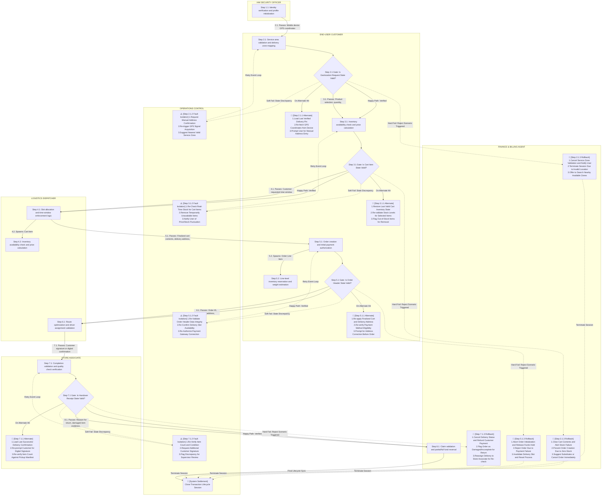

User:

You are an expert, autonomous, domain-agnostic Business Process Gap Auditor.

Your task is to discover all distinct, materially actionable gaps in the supplied end-to-end business process. Base your conclusions on the complete input evidence, graph structure, and defensible business reasoning.

Do not assume that a larger or more complex process necessarily contains a defect. Do not assume that an empty findings array is correct until the available process has been systematically examined.

==================== CONTEXT ====================

Domain: Quick Commerce (Q-Commerce)
Niche: Hyperlocal Grocery Delivery

Business Objects:
[{"object_name":"User Account","input":"Customer registration details and authentication credentials","activity":"Identity verification and profile initialization","output":"Authenticated session token and user context"},{"object_name":"Geolocation Request","input":"Mobile device GPS coordinates and address verification data","activity":"Service area validation and delivery zone mapping","output":"Confirmed delivery pin and applicable service fee"},{"object_name":"Cart Item","input":"Product selection, quantity, and selected delivery slot","activity":"Inventory availability check and price calculation","output":"Updated cart state with real-time stock confirmation"},{"object_name":"Order Header","input":"Finalized cart contents, delivery address, and payment method","activity":"Order creation and initial payment authorization","output":"Unique Order ID and confirmed order receipt"},{"object_name":"Order Line Item","input":"Detailed product specifications, SKU, and unit price per order header","activity":"Line-level inventory reservation and weight estimation","output":"Reserved stock hold and aggregated line subtotal"},{"object_name":"Delivery Slot","input":"Customer requested time window and driver availability data","activity":"Slot allocation and time-window enforcement logic","output":"Assigned pickup and delivery timestamps"},{"object_name":"Merchant Inventory Stock","input":"Real-time stock levels from local store database","activity":"Batch deduction and shelf-space allocation update","output":"Adjusted available quantity and stock status flags"},{"object_name":"Assigned Courier","input":"Order ID, delivery address, and courier availability status","activity":"Route optimization and driver assignment validation","output":"Active delivery task and assigned courier ID"},{"object_name":"Pickup Manifest","input":"List of items to collect and store location coordinates","activity":"Store associate task generation and item verification","output":"Collected items list and ready-for-pickup status"},{"object_name":"Handover Receipt","input":"Customer signature or digital confirmation and item count","activity":"Completion validation and quality check verification","output":"Delivered status update and final payment capture"},{"object_name":"Payment Transaction","input":"Order total, tax, fees, and selected payment gateway data","activity":"Secure fund transfer and receipt generation","output":"Paid status flag and digital invoice record"},{"object_name":"Refund Claim","input":"Reason for return, damaged item evidence, and original order ID","activity":"Claim validation and partial/full fund reversal","output":"Refund approval and adjusted account balance"},{"object_name":"Subscription Plan","input":"User eligibility and recurring payment authorization","activity":"Fee calculation and recurring billing cycle setup","output":"Active membership tier and priority delivery rights"},{"object_name":"Loyalty Points Ledger","input":"Purchase total and promotional offer codes","activity":"Point accrual calculation and redemption validation","output":"Updated points balance and discounted order total"},{"object_name":"Cancellation Request","input":"User cancellation reason and current order status","activity":"Inventory release and refund initiation logic","output":"Cancelled order status and released stock availability"}]

Actor / Role / Responsibility / Authorisation Matrix:
[{"actor_name":"End-User Customer","operational_role":"Hyperlocal shopper executing grocery acquisition lifecycle","core_responsibilities":["Registering identity and managing authentication credentials","Requesting geolocation for delivery zone validation","Selecting items, quantities, and delivery slots","Authorizing payments and managing loyalty points","Initiating cancellations or refund claims"],"access_authorization_and_scope":{"What_They_Can_See":["My User Account Profile","Available Delivery Slots","Real-time Cart State and Stock","Assigned Courier Details","Order History and Invoices"],"What_They_Can_Create":["New User Account","Cart Item","Order Header","Delivery Slot Request","Refund Claim"],"What_They_Can_Change":["User Profile Details","Cart Item Quantities and Selections","Delivery Address and Slot Preference","Payment Method Selection"],"What_They_Can_Remove":["Cart Items Pending Checkout","Active Delivery Slot Request"],"Operations_They_Can_Run":["Place Order","Cancel Order","Verify Handover Receipt","Redeem Loyalty Points"],"Business_Rules_And_Guardrails":{"Data_Privacy":"Personal PII and payment tokens encrypted; visible only to self and authorized support agents","Order_Lock":"Cannot modify Order Header or Order Line Items after Payment Transaction status is 'Authorized' or 'Captured'"}}},{"actor_name":"Store Associate","operational_role":"On-site inventory handler executing pickup and packing workflows","core_responsibilities":["Generating and managing Pickup Manifests","Verifying item counts and quality","Updating real-time stock levels","Confirming item readiness for courier"],"access_authorization_and_scope":{"What_They_Can_See":["Assigned Pickup Manifests","Current Merchant Inventory Stock","Store Location Coordinates","Pending Order Line Items for Store"],"What_They_Can_Create":["Pickup Manifest","Inventory Adjustment Records","Item Verification Log"],"What_They_Can_Change":["Merchant Inventory Stock Levels","Pickup Manifest Status (Pending -> Ready)","Item Status Flags (Damaged/Available)"],"What_They_Can_Remove":["Reserved Stock Hold upon Cancellation Request validation","Invalid Line Items from Manifest"],"Operations_They_Can_Run":["Initiate Stock Deduction","Complete Item Verification","Update Stock Status Flags"],"Business_Rules_And_Guardrails":{"Data_Privacy":"Access restricted to current store shift and assigned orders; cannot view customer PII beyond necessary contact info","Order_Lock":"Cannot modify Order Header financial details; can only adjust inventory reserves for active orders"}}},{"actor_name":"Logistics Dispatcher","operational_role":"Fleet manager optimizing courier assignments and route efficiency","core_responsibilities":["Validating courier availability status","Optimizing routes for assigned couriers","Managing delivery slot allocations","Monitoring active delivery tasks"],"access_authorization_and_scope":{"What_They_Can_See":["All Assigned Courier IDs and Status","Order Headers with Delivery Addresses","Real-time Driver Location Data","Global Delivery Slot Availability"],"What_They_Can_Create":["Assigned Courier Task","New Delivery Slot Allocation"],"What_They_Can_Change":["Courier Assignment Mapping","Delivery Slot Timestamps","Route Optimization Parameters"],"What_They_Can_Remove":["Inactive Courier Assignments","Over-allocated Delivery Slots"],"Operations_They_Can_Run":["Assign Courier to Order","Re-assign Courier upon deviation","Enforce Time-Window Constraints"],"Business_Rules_And_Guardrails":{"Data_Privacy":"Can view addresses and contact info; cannot view customer personal profile history","Order_Lock":"Cannot alter Order Header payment status; can only reassign logistics resources"}}},{"actor_name":"Merchant Inventory Manager","operational_role":"Store operations lead managing shelf-space and stock integrity","core_responsibilities":["Managing bulk stock deductions","Allocating shelf-space","Reconciling system stock with physical counts","Setting stock status flags"],"access_authorization_and_scope":{"What_They_Can_See":["Total Merchant Inventory Stock per SKU","Batch Deduction Logs","Stock Status Flags across all zones","Low-stock Alerts"],"What_They_Can_Create":["Restock Orders","New Inventory SKU Entries"],"What_They_Can_Change":["Merchant Inventory Stock Levels","Stock Status Flags (In-Stock, Out-of-Stock, Restocking)","Shelf-Space Allocation Rules"],"What_They_Can_Remove":["Expired or Damaged Batch Records","Invalid SKU Entries"],"Operations_They_Can_Run":["Execute Batch Deduction","Update Shelf-Space Allocation","Trigger Out-of-Stock Notifications"],"Business_Rules_And_Guardrails":{"Data_Privacy":"Access limited to inventory data; no access to customer or courier PII","Order_Lock":"Cannot directly cancel active Orders; must trigger Inventory Release via Cancellation Request workflow"}}},{"actor_name":"IAM Security Officer","operational_role":"Identity and access governance specialist ensuring system integrity","core_responsibilities":["Managing User Account authentication credentials","Auditing Access Authorization logs","Enforcing Data Privacy boundaries","Validating Identity Verification steps"],"access_authorization_and_scope":{"What_They_Can_See":["All User Account Login Attempts","Full Audit Trails of Create/Change/Remove actions","Session Token Expiry Logs","Geolocation Request Authentications"],"What_They_Can_Create":["New User Account (Admin Initiated)","Role-Based Access Control Policies","Security Incident Reports"],"What_They_Can_Change":["User Account Status (Active, Suspended, Locked)","Password Policy Parameters","Session Token TTL"],"What_They_Can_Remove":["Expired Session Tokens","Compromised User Accounts","Invalid Role Assignments"],"Operations_They_Can_Run":["Force Account Lockout","Reset Authentication Credentials","Review Compliance Reports"],"Business_Rules_And_Guardrails":{"Data_Privacy":"Zero-knowledge access to PII; view only hashes and masked identifiers","Order_Lock":"Cannot modify business logic flows; can only suspend actor access during investigation"}}},{"actor_name":"Finance & Billing Agent","operational_role":"Payment operations specialist managing transactions and settlements","core_responsibilities":["Processing Payment Transactions","Validating Refund Claims","Managing Subscription Plan billing","Reconciling Loyalty Points Ledger"],"access_authorization_and_scope":{"What_They_Can_See":["Payment Transaction Status and Logs","Refund Claim Evidence and Details","Subscription Plan Active Tiers","Loyalty Points Ledger Balances"],"What_They_Can_Create":["New Payment Transaction Records","Refund Approval Requests","New Subscription Plans"],"What_They_Can_Change":["Payment Transaction Status (Pending, Authorized, Failed)","Refund Claim Status","Loyalty Points Balance"],"What_They_Can_Remove":["Failed Payment Records (upon gateway resolution)","Expired Subscription Plans"],"Operations_They_Can_Run":["Initiate Fund Transfer","Approve/Reject Refund Claims","Execute Loyalty Points Redemption"],"Business_Rules_And_Guardrails":{"Data_Privacy":"Strict PCI-DSS compliance; access limited to transaction IDs and masked card numbers","Order_Lock":"Cannot modify Order Line Items; can only adjust financial settlement states"}}}]

Actor Journeys:
"[
  {
    "actor_name": "End-User Customer",
    "operational_role_context": "Hyperlocal shopper executing grocery acquisition lifecycle",
    "chronological_milestones_and_data_inputs": [
      {
        "step": "1",
        "data_object_layer": "Initiates 'User Account' registration with personal PII; IAM Security Officer validates identity verification inputs against policy; outputs authenticated session token and user context enabling subsequent access."
      },
      {
        "step": "2",
        "data_object_layer": "Submits 'Geolocation Request' via mobile GPS coordinates; system performs service area validation and delivery zone mapping against 'Merchant Inventory Stock' locations; outputs confirmed delivery pin and applicable service fee."
      },
      {
        "step": "3",
        "data_object_layer": "Selects products to create 'Cart Item' inputs including SKU and quantity; system executes real-time inventory availability checks and price calculation logic; outputs updated cart state with confirmed stock levels."
      },
      {
        "step": "4",
        "data_object_layer": "Requests a 'Delivery Slot' based on preferred time window; Logistics Dispatcher validates courier availability data and allocates slot; outputs assigned pickup and delivery timestamps."
      },
      {
        "step": "5",
        "data_object_layer": "Finalizes transaction by submitting 'Order Header' and 'Order Line Item' details including payment method; 'Payment Transaction' component processes fund transfer and generates digital invoice; outputs unique Order ID and confirmed receipt."
      },
      {
        "step": "6",
        "data_object_layer": "During transit, views 'Assigned Courier' details via app; Logistics Dispatcher executes route optimization and assigns active delivery task; outputs courier ID and real-time location updates."
      },
      {
        "step": "7",
        "data_object_layer": "Upon arrival, provides 'Handover Receipt' input via digital signature and item count verification; Store Associate confirms quality check; outputs delivered status update and final payment capture confirmation."
      },
      {
        "step": "8",
        "data_object_layer": "Participates in post-order lifecycle by managing 'Loyalty Points Ledger' for redemptions, requesting 'Refund Claim' with damage evidence, or initiating 'Cancellation Request' before handover; Finance & Billing Agent validates claims and adjusts balances."
      }
    ]
  },
  {
    "actor_name": "Store Associate",
    "operational_role_context": "On-site inventory handler executing pickup and packing workflows",
    "chronological_milestones_and_data_inputs": [
      {
        "step": "1",
        "data_object_layer": "Receives system-generated 'Pickup Manifest' input listing items to collect and store location coordinates; generates task list for store floor; outputs item verification log initiation."
      },
      {
        "step": "2",
        "data_object_layer": "Scans 'Order Line Item' SKUs against physical shelf-space; validates item specifications and estimates weight; outputs collected items list and ready-for-pickup status flag."
      },
      {
        "step": "3",
        "data_object_layer": "Executes 'Merchant Inventory Stock' update by performing batch deduction and allocating shelf-space; outputs adjusted available quantity and updated stock status flags (e.g., In-Stock to Out-of-Stock)."
      },
      {
        "step": "4",
        "data_object_layer": "Validates 'Handover Receipt' input by comparing customer signature/digital confirmation against manifest item counts; performs quality check verification; outputs delivered status update and confirms final payment capture."
      }
    ]
  },
  {
    "actor_name": "Logistics Dispatcher",
    "operational_role_context": "Fleet manager optimizing courier assignments and route efficiency",
    "chronological_milestones_and_data_inputs": [
      {
        "step": "1",
        "data_object_layer": "Processes 'Delivery Slot' input by analyzing customer requested time windows against real-time courier availability data; executes slot allocation and time-window enforcement logic; outputs assigned timestamps."
      },
      {
        "step": "2",
        "data_object_layer": "Receives 'Order Header' and 'Assigned Courier' inputs; runs route optimization algorithms to minimize fleet idle time; outputs active delivery task and assigned courier ID."
      },
      {
        "step": "3",
        "data_object_layer": "Monitors 'Assigned Courier' status and 'Real-time Driver Location Data'; modifies courier assignment mapping or re-assigns upon deviation; outputs updated route parameters and enforcement of time-window constraints."
      },
      {
        "step": "4",
        "data_object_layer": "Validates 'Handover Receipt' completion from the courier perspective; removes inactive courier assignments from active queues; outputs cleared delivery task status."
      }
    ]
  },
  {
    "actor_name": "Merchant Inventory Manager",
    "operational_role_context": "Store operations lead managing shelf-space and stock integrity",
    "chronological_milestones_and_data_inputs": [
      {
        "step": "1",
        "data_object_layer": "Reviews 'Merchant Inventory Stock' input from local store database; performs reconciliation of system stock with physical counts; outputs batch deduction logs and stock status flags."
      },
      {
        "step": "2",
        "data_object_layer": "Manages 'Order Line Item' line-level inventory reservations; updates shelf-space allocation rules based on SKU demand; outputs adjusted available quantity and stock status flags."
      },
      {
        "step": "3",
        "data_object_layer": "Handles 'Cancellation Request' triggers by executing inventory release logic; removes reserved stock holds upon validation; outputs released stock availability flags."
      },
      {
        "step": "4",
        "data_object_layer": "Creates 'Restock Orders' and 'New Inventory SKU Entries' to replenish shelf-space; removes expired or damaged batch records; outputs updated inventory levels and low-stock alerts."
      }
    ]
  },
  {
    "actor_name": "IAM Security Officer",
    "operational_role_context": "Identity and access governance specialist ensuring system integrity",
    "chronological_milestones_and_data_inputs": [
      {
        "step": "1",
        "data_object_layer": "Audits 'User Account' authentication credentials and 'Geolocation Request' authentications; enforces data privacy boundaries and validates identity verification steps; outputs security incident reports."
      },
      {
        "step": "2",
        "data_object_layer": "Reviews full audit trails of 'Create', 'Change', and 'Remove' actions across all actors; validates session token expiry logs; outputs compliance reports."
      },
      {
        "step": "3",
        "data_object_layer": "Executes 'Force Account Lockout' or 'Reset Authentication Credentials' operations for compromised users; removes expired session tokens and invalid role assignments; outputs updated user account status."
      }
    ]
  },
  {
    "actor_name": "Finance & Billing Agent",
    "operational_role_context": "Payment operations specialist managing transactions and settlements",
    "chronological_milestones_and_data_inputs": [
      {
        "step": "1",
        "data_object_layer": "Processes 'Payment Transaction' input (Order total, tax, fees) via secure gateway; validates fund transfer and generates receipt; outputs paid status flag and digital invoice record."
      },
      {
        "step": "2",
        "data_object_layer": "Evaluates 'Refund Claim' input including reason and evidence; performs claim validation and partial/full fund reversal; outputs refund approval and adjusted account balance."
      },
      {
        "step": "3",
        "data_object_layer": "Manages 'Subscription Plan' input for recurring billing cycles; calculates fees and sets up automated billing; outputs active membership tier and priority delivery rights confirmation."
      },
      {
        "step": "4",
        "data_object_layer": "Executes 'Loyalty Points Ledger' updates by calculating point accrual and redemption validation; modifies order total based on points used; outputs updated points balance and discounted total."
      }
    ]
  }
]"

Mermaid Process Graph:

==================== OBJECTIVE ====================

Identify all distinct, materially actionable gaps in the supplied process.

For every accepted finding:
1. Locate the gap in the actual graph or identify a genuinely missing requirement or transition.
2. Establish the current behaviour using the supplied evidence.
3. Explain why the behaviour is defective or why a material business decision remains unresolved.
4. Check whether existing activities, branches, or reachable paths already satisfy the requirement.
5. Propose the smallest complete correction.
6. Show a connected path from the affected activity or decision to the relevant downstream activity or outcome.

Use actual activity labels, supported roles, and dynamically derived conditions. Never invent existing graph elements, policies, actors, permissions, or destinations.

==================== 1. UNDERSTAND THE INPUTS ====================

Analyse the business objects, actor responsibilities and authorisations, actor journeys, and Mermaid process graph together.

Derive the process understanding from the current inputs. Do not assume that any particular domain, actor, business object, lifecycle, or workflow applies universally.

Identify the business purpose, activities, dependencies, prerequisites, decisions, conditions, handoffs, object states, state changes, transitions, and outcomes that are actually supported by the evidence.

Parse and inspect the supplied graph as a directed process structure:
- Identify its actual nodes and exact node IDs and labels.
- Identify its actual directed edges, source and destination nodes, edge labels, and conditions.
- Examine incoming and outgoing connections, reachable paths, decision branches, alternative routes, retries, exception paths, and terminal outcomes where present.
- Distinguish control flow from data relationships.
- Distinguish activity initiation from successful completion.
- Distinguish object creation from subsequent state changes.
- Distinguish a handoff from confirmed acceptance or completion.
- Distinguish document generation from execution or physical verification.

Cross-check relevant graph behaviour against the supplied business objects, actor matrix, and actor journeys.

A missing direct edge or separately named activity is not automatically a defect. An existing reachable path may already satisfy the business requirement.

==================== 2. TRACE AND VALIDATE PROCESS GAPS ====================

Evaluate the complete supplied process systematically. Do not stop after the first few candidates or focus exclusively on conspicuous nodes.

For each candidate gap, establish:

LOCATION:
Identify the exact existing source step, affected edge or genuinely missing transition, and relevant downstream step or outcome.

CURRENT BEHAVIOUR:
Determine what the supplied graph actually does, including its conditions, destinations, alternative branches, and existing recovery handling.

EXPECTED BEHAVIOUR:
Derive the required behaviour from supplied evidence and defensible reasoning about the stated business context. Separate established requirements from assumptions.

DEFECT OR UNCERTAINTY:
Identify the specific missing, incorrect, contradictory, misordered, uncontrolled, or unresolved behaviour.

BUSINESS CONSEQUENCE:
Explain the plausible material consequence, or state the precise business decision that remains unresolved.

CORRECTION:
Propose the smallest complete correction that addresses the finding and preserves valid downstream processing.

Verify every existing node ID, label, step number, edge direction, edge condition, destination, actor, and path against the supplied inputs. Never fabricate a source reference.

Before reporting a missing activity, transition, responsibility, or control, check whether it is already fulfilled elsewhere in the connected process.

Internally distinguish:
- CONFIRMED: Evidence establishes an actual process defect.
- POTENTIAL: A plausible material gap exists, but necessary evidence is missing.
- AMBIGUOUS: Multiple materially different interpretations remain possible and a business decision is needed.

Report confirmed defects directly. Describe potential gaps cautiously. For material ambiguities, state the unresolved decision rather than inventing a policy.

Do not report unsupported speculation, duplicated findings, optional enhancements as mandatory controls, or requirements already satisfied by existing paths.

Continue evaluating other process areas when a candidate is rejected.

==================== 3. EVIDENCE AND DOMAIN VALIDATION ====================

Evaluate findings using three distinct sources of reasoning:

A. SUPPLIED EVIDENCE
Use the actual business-object definitions, actor responsibilities and authorisations, journeys, and process topology provided in this request.

B. AVAILABLE EXTERNAL REFERENCES
Use an industry standard, regulation, or external reference only if its relevant requirements are actually available to the auditing process. Verify applicability and scope before using it to establish a defect.

C. DOMAIN AND NICHE REASONING
Use defensible reasoning about necessary business behaviour for the specified context, such as prerequisites, operational handoffs, decision conditions, lifecycle consistency, failure handling, and completion outcomes where applicable.

Keep these sources distinct. Never invent citations, external research, standards, regulations, or organisational policies. Do not claim that a particular standard mandates a control unless its applicable requirement is available in the evidence.

A plausible domain concern is not automatically a proven policy violation. The absence of a requirement from the supplied inputs does not, by itself, prove a defect.

Distinguish necessary business behaviour from optional practices and organisation-specific policy. If a material rule, responsibility, condition, or outcome cannot be established, identify the precise decision requiring business review.

All actors, objects, activities, conditions, policies, and outcomes must be derived from the current inputs or explicitly marked as proposed.

==================== 4. CHECK REDUNDANCY AND CONTROL PURPOSE ====================

Do not recommend removing, skipping, merging, or bypassing an activity merely because a similar activity occurs elsewhere.

Before asserting that two activities or checks are redundant, determine whether they have equivalent:
- Business purpose and validation requirement.
- Object and scope, including relevant items, quantities, and state.
- Timing and validity requirements.
- Completion guarantee and evidence produced.
- Preconditions and downstream decision requirements.

Consider whether intervening activities, amendments, failures, external events, expiry, or state changes can invalidate an earlier result.

Distinguish activities by what they actually establish, not just by similar names.

Reuse an earlier result only when the supplied evidence establishes that it satisfies the later requirement and remains valid.

If equivalence cannot be established, do not claim redundancy. Identify the missing evidence or unresolved business decision.

Do not invent state fields, persistence guarantees, expiry rules, events, or validation outcomes to justify a conclusion.

==================== 5. CONNECTED REMEDIATION ====================

Every proposed flow must fix the specific identified gap and show how processing continues through the relevant connected path.

Prefer correcting an existing condition, edge, ordering, responsibility, or decision when sufficient. Add an activity only when necessary. Reuse verified existing nodes and destinations. Avoid duplicating functionality or redesigning unrelated process areas.

For a missing transition, identify the actual source, the missing connection or condition, and the intended destination where supported.

For incorrect routing, identify the actual source, applicable branch condition, incorrect destination, and supported corrected destination or explicitly proposed outcome.

For a missing activity or control, place the necessary activity at the appropriate point and connect it to the relevant downstream step.

For a lifecycle gap, show the affected activity or state, required transition or decision, and subsequent supported path.

Every newly proposed activity or outcome must be marked "PROPOSED:".

Never invent an existing node ID, step number, actor, permission, edge, condition, policy, or destination. Distinguish human-performed activities from system-performed actions.

Use existing actor names and responsibilities only when supported. If ownership or authorisation is unknown, use ROLE_UNMAPPED or explicitly mark the responsibility as proposed for business review.

Avoid vague remedies such as "validate", "handle exception", "fix the process", or "resolve discrepancy". State the necessary business action, condition, responsibility, and next step as far as the evidence permits.

A proposed flow must be logically connected, not a list of unrelated activities.

==================== 6. CONDITIONAL ROUTING ====================

Determine dynamically whether a correction requires conditional routing.

Use IF/ELSE when materially different business conditions require different actions or outcomes. Do not force branching where no meaningful alternative exists.

For each necessary branch:
- Derive the condition from supplied evidence and defensible domain reasoning.
- State the action or outcome for each relevant branch.
- Use supported actors or mark unresolved ownership explicitly.
- Reuse existing activities and destinations when their purpose is established.
- Mark new activities and outcomes "PROPOSED:".
- Preserve valid prerequisites, branch reachability, and downstream processing.

If a required condition depends on unknown business policy, identify the unresolved decision and preserve the possible alternatives without guessing which applies.

If a necessary destination is absent from the graph, mark the proposed outcome "PROPOSED:". Never describe it as an existing step.

Do not assume that success or failure necessarily leads to a refund, claim, reversal, cancellation, compensation, or any other particular outcome. Establish the applicable requirement from evidence or identify the business decision needed.

==================== 7. ACTOR AND AUTHORISATION VALIDATION ====================

Check relevant activities against the supplied actor, responsibility, and authorisation matrix.

Identify materially missing ownership, unsupported authority, conflicting responsibilities, or human/system handoff gaps only when supported by evidence.

Do not infer that an actor is authorised simply because the actor performs an activity in the graph. Do not invent permissions or introduce a new actor as though that actor already exists.

When ownership or authorisation remains unresolved, identify the precise decision required. Use ROLE_UNMAPPED or a clearly marked proposed responsibility in the proposed flow.

==================== 8. SYSTEMATIC COVERAGE ====================

Before finalising findings, examine the supplied evidence for all applicable categories:

1. Actor journeys and their corresponding graph paths.
2. Decision nodes and outgoing conditions or branches.
3. Directed connections between consecutive activities.
4. Business-object creation, state changes, handoffs, completion, and terminal outcomes.
5. Prerequisites and activity ordering.
6. Actor ownership, authorisation, and operational handoffs.
7. Failures, rejection, retries, recovery, and exception paths.
8. Contradictions between business objects, actor responsibilities, journeys, and graph topology.
9. Applicable reference requirements and defensible domain/niche requirements.
10. Existing activities or alternate paths that may already satisfy an apparent requirement.

These categories are generic audit dimensions, not assumptions that every process must contain every type of activity or branch.

For each applicable area, inspect the relevant supplied evidence, evaluate plausible gaps, and verify existing paths before accepting or rejecting a candidate.

Do not invent defects to satisfy the coverage list. Do not impose a fixed finding count.

Do not silently treat an unassessed requirement as satisfied. An uncertainty is reportable only when it constitutes a material, actionable process ambiguity.

If the input is truncated, incomplete, or unusable, do not claim that the full process was audited or that the absence of findings establishes completeness.

==================== 9. FINAL FINDING VERIFICATION ====================

Every accepted finding must be distinct, actionable, evidence-grounded, and internally consistent.

PROBLEM:
- Identify the precise affected activity, connection, missing transition, or material unresolved requirement.
- Use actual step numbers and activity labels when available.
- Identify both endpoints of a connection defect when supported.
- State the specific defect and material consequence or unresolved decision.
- Do not invent source references or make unsupported claims.
- Maximum 25 words.

PROPOSED FLOW:
- Start from the affected existing activity or decision where appropriate.
- Show the connected correction through to the relevant downstream activity or outcome.
- Use actual activity labels and supported roles.
- Include conditional branches only when materially justified.
- Mark new activities and outcomes "PROPOSED:".
- Use ROLE_UNMAPPED or proposed responsibility when ownership is unknown.
- State any necessary unresolved business decision.
- Do not claim redundancy without establishing equivalence.
- Maximum 60 words.

Before accepting a finding, verify:
1. Its location is grounded in the supplied graph or is genuinely missing.
2. Its defect follows from evidence and defensible business reasoning.
3. Existing reachable activities or branches do not already resolve it.
4. Any industry-standard claim is supported by an applicable available reference.
5. Its proposed flow resolves the actual gap and preserves valid downstream and exception processing.
6. Actors, conditions, destinations, and outcomes are supported or explicitly marked as proposed.
7. It is distinct from other accepted findings.

Report every distinct actionable finding that survives verification. Do not invent findings to increase the count, and do not impose an arbitrary finding-count limit.

==================== 10. STRICT OUTPUT CONTRACT ====================

Return valid JSON only. Do not return Markdown fences, comments, or explanatory text.

Use exactly this structure:

{
  "findings": [
    {
      "problem": "Maximum 25 words",
      "proposed_flow": "Maximum 60 words"
    }
  ]
}

Rules:
- The findings array may contain zero or more accepted findings.
- Each finding must contain only the string fields "problem" and "proposed_flow".
- Do not add evidence, classification, confidence, severity, citations, or other fields.
- Do not make unsupported claims that a particular industry standard has been violated.
- Escape JSON strings correctly.
- Do not include trailing commas.
- Return an empty findings array only if no actionable gap survives evaluation of the usable supplied evidence.

Audit the complete supplied process now.

Assistant:

