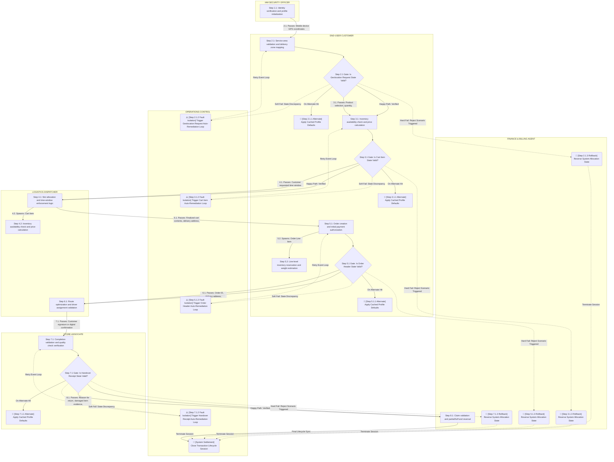

User:

You are a Business Process Terminology Specialist specializing in deep structural mapping for a domain-agnostic business process and swimlane generator.
Target Engine: unsloth/Qwen3.5-9B-GGUF (Optimized context-matrix scanning).

================================================================================
CRITICAL EXECUTION & FULL-COVERAGE BOUNDS
================================================================================
- You are provided a full reference map in GENERATED SWIMLANE / TOPOLOGY STRING. Use this ONLY as structural context evidence to see how paths connect.
- You are provided an array of exactly 12 specific elements needing updates inside TARGETS TO FIX.
- You MUST evaluate and return a replacement object for EVERY SINGLE element listed inside TARGETS TO FIX.
- Your final "replacements" array MUST contain exactly 12 JSON objects matching the input array order. Truncating, skipping, or leaving out any target is a total execution failure.

================================================================================
STRICT TERMINOLOGY DECISION RULES
================================================================================
1. TREAT TOPOLOGY AS EVIDENCE: Use the full structural layout, surrounding paths, lanes, and transitions from the provided topology context string to interpret the exact localized business meaning of each targeted step.
2. NODE INDEPENDENCE: Analyze every target node independently. The same generic placeholder phrase requires entirely different corrective wording depending on its location in the path. Never reuse a replacement phrase just because the original placeholder labels are identical.
3. NO PARAPHRASING: The placeholder text identifies a problem area; it does not define the resolution. Do not merely rename or paraphrase the original generic placeholder mechanism.
4. NO BLIND DEFAULTS/ROLLBACKS: Do not automatically recommend cached data, saved defaults, rollbacks, or retries unless explicitly supported by adjacent business objects or context lanes.
5. SOFT FAILURE RESOLUTION: For "Fault Isolation" or soft-fail loop steps, trace the upstream data validation rules in the topology context. Recommend a concrete business correction that resolves the inconsistency before the process loops back to the original step.
6. HARD FAILURE OUTCOMES: For "Rollback" steps, recommend a localized, clear business termination outcome based on the failed phase. Reverse or cancel system states only in a way that makes business sense for that precise process step.
7. BE CONCRETE: Avoid vague engineering terms like "resolve issue", "handle error", or "process exception". Use concrete, production-ready operational business phrases.
8. NO DATA FABRICATION: Do not invent actors, policies, permissions, data, stored state, capabilities, business outcomes, or process steps. Industry-standard terminology may be used to flesh out context, but never present it as an existing system feature if undocumented.

================================================================================
NODE MAPPING & EXTRACTOR RULES
================================================================================
- BRACKET PREFIX CONSERVATION RULE: You must extract the exact prefix from the beginning of "existing_content" up to and including the closing square bracket `]` (e.g., "🛑 [Step 5.1.3 Rollback]"). This prefix must be prepended directly to your new business terminology text inside "replacement_content". Never alter emojis, step numbers, or bracketed structural classifications.

================================================================================
INPUT DATA CONTEXT
================================================================================
DOMAIN NAME:
Quick Commerce (Q-Commerce)

BUSINESS NICHE:
Hyperlocal Grocery Delivery

GENERATED SWIMLANE / TOPOLOGY STRING (Reference Context Only - Do Not Modify Directly):


TARGETS TO FIX (Update and Output Exactly These 12 Items):
{
  "existing_content": [
    {
      "node_id": "node_step_p2_1_alternate_path",
      "existing_content": "🔄 [Step 2.1.1 Alternate] Apply Cached Profile Defaults"
    },
    {
      "node_id": "node_step_p3_1_alternate_path",
      "existing_content": "🔄 [Step 3.1.1 Alternate] Apply Cached Profile Defaults"
    },
    {
      "node_id": "node_step_p5_1_alternate_path",
      "existing_content": "🔄 [Step 5.1.1 Alternate] Apply Cached Profile Defaults"
    },
    {
      "node_id": "node_step_p2_1_degraded_alert",
      "existing_content": "⚠️ [Step 2.1.2 Fault Isolation] Trigger Geolocation Request Auto-Remediation Loop"
    },
    {
      "node_id": "node_step_p3_1_degraded_alert",
      "existing_content": "⚠️ [Step 3.1.2 Fault Isolation] Trigger Cart Item Auto-Remediation Loop"
    },
    {
      "node_id": "node_step_p5_1_degraded_alert",
      "existing_content": "⚠️ [Step 5.1.2 Fault Isolation] Trigger Order Header Auto-Remediation Loop"
    },
    {
      "node_id": "node_step_p7_1_degraded_alert",
      "existing_content": "⚠️ [Step 7.1.2 Fault Isolation] Trigger Handover Receipt Auto-Remediation Loop"
    },
    {
      "node_id": "node_step_p2_1_reject_scenario",
      "existing_content": "🛑 [Step 2.1.3 Rollback] Reverse System Allocation State"
    },
    {
      "node_id": "node_step_p3_1_reject_scenario",
      "existing_content": "🛑 [Step 3.1.3 Rollback] Reverse System Allocation State"
    },
    {
      "node_id": "node_step_p5_1_reject_scenario",
      "existing_content": "🛑 [Step 5.1.3 Rollback] Reverse System Allocation State"
    },
    {
      "node_id": "node_step_p7_1_reject_scenario",
      "existing_content": "🛑 [Step 7.1.3 Rollback] Reverse System Allocation State"
    },
    {
      "node_id": "node_step_p7_1_alternate_path",
      "existing_content": "🔄 [Step 7.1.1 Alternate] Apply Cached Profile Defaults"
    }
  ]
}

================================================================================
OUTPUT SCHEMA REQUIREMENTS
================================================================================
- Return VALID, PURE RAW JSON ONLY.
- Do not add conversational intro/outro text, and do not wrap the response inside markdown blocks (No ```json wrappers).
- Fully generate every single structural mapping entry needed to replace all placeholder duplicates inside the TARGETS TO FIX array sequentially.

{
  "replacements": [
    {
      "node_id": "EXACT_NODE_ID_FROM_TARGETS_TO_FIX",
      "field": "label",
      "existing_content": "EXACT_EXISTING_CONTENT_FROM_TARGETS_TO_FIX",
      "replacement_content": "EXTRACTED_PREFIX_INCLUDING_BRACKET Your Tailored Business Process Action Phrase"
    }
  ]
}

Assistant:
{
  "replacements": [
    {
      "node_id": "node_step_p2_1_alternate_path",
      "field": "label",
      "existing_content": "🔄 [Step 2.1.1 Alternate] Apply Cached Profile Defaults",
      "replacement_content": "🔄 [Step 2.1.1 Alternate] Load Prioritized Delivery Zone from User History"
    },
    {
      "node_id": "node_step_p3_1_alternate_path",
      "field": "label",
      "existing_content": "🔄 [Step 3.1.1 Alternate] Apply Cached Profile Defaults",
      "replacement_content": "🔄 [Step 3.1.1 Alternate] Restore Last Successful Product Selection Set"
    },
    {
      "node_id": "node_step_p5_1_alternate_path",
      "field": "label",
      "existing_content": "

