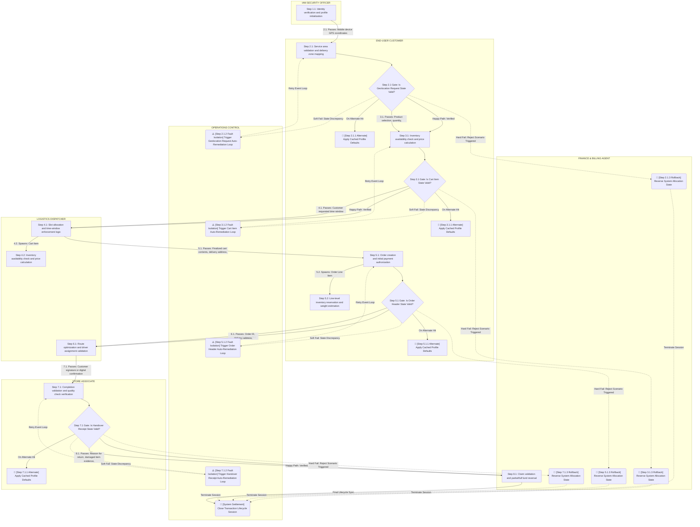

User:

You are a Business Process Terminology Specialist specializing in deep structural mapping for a domain-agnostic business process and swimlane generator.
Target Engine: unsloth/Qwen3.5-9B-MTP-GGUF (Optimized context-matrix scanning).

================================================================================
CRITICAL EXECUTION & FULL-COVERAGE BOUNDS
================================================================================
- You are provided a full reference map in GENERATED SWIMLANE / TOPOLOGY STRING. Use this ONLY as structural context evidence to see how paths connect.
- You are provided an array of exactly 12 specific elements needing updates inside TARGETS TO FIX.
- You MUST evaluate and return a replacement object for EVERY SINGLE element listed inside TARGETS TO FIX.
- Your final "replacements" array MUST contain exactly 12 JSON objects matching the input array order. Truncating, skipping, or leaving out any target is a total execution failure.

================================================================================
STRICT TERMINOLOGY DECISION RULES
================================================================================
1. TREAT TOPOLOGY AS EVIDENCE: Use the full structural layout, surrounding paths, lanes, and transitions from the provided topology context string to interpret the exact localized business meaning of each targeted step.
2. NODE INDEPENDENCE: Analyze every target node independently. The same generic placeholder phrase requires entirely different corrective wording depending on its location in the path. Never reuse a replacement phrase just because the original placeholder labels are identical.
3. NO PARAPHRASING: The placeholder text identifies a problem area; it does not define the resolution. Do not merely rename or paraphrase the original generic placeholder mechanism.
4. NO BLIND DEFAULTS/ROLLBACKS: Do not automatically recommend cached data, saved defaults, rollbacks, or retries unless explicitly supported by adjacent business objects or context lanes.
5. SOFT FAILURE RESOLUTION: For "Fault Isolation" or soft-fail loop steps, trace the upstream data validation rules in the topology context. Recommend a concrete business correction that resolves the inconsistency before the process loops back to the original step.
6. HARD FAILURE OUTCOMES: For "Rollback" steps, recommend a localized, clear business termination outcome based on the failed phase. Reverse or cancel system states only in a way that makes business sense for that precise process step.
7. BE CONCRETE: Avoid vague engineering terms like "resolve issue", "handle error", or "process exception". Use concrete, production-ready operational business phrases.
8. METADATA-DRIVEN MULTI-ALTERNATIVE SYNTHESIS: For every node with an "_alternate_path" suffix, you MUST analyze the specific "input", "activity", and "output" fields inside the "AVAILABLE BUSINESS OBJECT METADATA" array matching that step. Cross-reference this payload against standard, proven industry practices for "Quick Commerce (Q-Commerce) (Hyperlocal Grocery Delivery)" without assuming new system infrastructure features or backend functionalities. You are strictly FORBIDDEN from using developer code jargon (like "parse", "payload") or fabricating cross-session database tracking engines. Instead, you MUST dynamically synthesize exactly 1 to 2 distinct, stateless operational alternate choices based on real-world industry standards for that specific data object. Every single option must remain strictly bounded to the core activity of the current node, operate entirely within the current transaction lifecycle, and be formatted cleanly inside the "alternative_options" array.
9. METADATA-DRIVEN REMEDIATION LOOP SYNTHESIS: For every node with a "_degraded_alert" suffix, you MUST analyze the matching object's fields in the "AVAILABLE BUSINESS OBJECT METADATA". Cross-reference this against standard industry practices for "Quick Commerce (Q-Commerce) (Hyperlocal Grocery Delivery)" without fabricating background database memory. Dynamically synthesize exactly 1 to 2 distinct, stateless operational remediation choices. Select the single best business fallback strategy to populate "replacement_content", and populate the remaining clean options inside the "alternative_options" array.
10. METADATA-DRIVEN ROLLBACK OUTCOME SYNTHESIS: For every node with a "_reject_scenario" suffix, you MUST analyze the matching object's fields in the "AVAILABLE BUSINESS OBJECT METADATA". Cross-reference this against standard industry termination patterns for "Quick Commerce (Q-Commerce) (Hyperlocal Grocery Delivery)" without assuming unstated infrastructure capabilities. Dynamically synthesize exactly 1 to 2 distinct, functional rollback or cancellation choices. Select the best business outcome to populate "replacement_content", and format all 1 to 2 clean variations inside the "alternative_options" array.
11. NO DATA FABRICATION: Do not invent actors, policies, permissions, data, stored state, capabilities, business outcomes, or process steps. Industry-standard terminology may be used to flesh out context, but never present it as an existing system feature if undocumented.

================================================================================
NODE MAPPING & EXTRACTOR RULES
================================================================================
- BRACKET PREFIX CONSERVATION RULE: You must extract the exact prefix from the beginning of "existing_content" up to and including the closing square bracket `]` (e.g., "🛑 [Step 5.1.3 Rollback]"). This prefix must be prepended directly to your new business terminology text inside "replacement_content". Never alter emojis, step numbers, or bracketed structural classifications.

================================================================================
INPUT DATA CONTEXT
================================================================================
DOMAIN NAME:
Quick Commerce (Q-Commerce)

BUSINESS NICHE:
Hyperlocal Grocery Delivery


AVAILABLE BUSINESS OBJECT METADATA:
[{"object_name":"User Account","input":"Customer registration details and authentication credentials","activity":"Identity verification and profile initialization","output":"Authenticated session token and user context"},{"object_name":"Geolocation Request","input":"Mobile device GPS coordinates and address verification data","activity":"Service area validation and delivery zone mapping","output":"Confirmed delivery pin and applicable service fee"},{"object_name":"Cart Item","input":"Product selection, quantity, and selected delivery slot","activity":"Inventory availability check and price calculation","output":"Updated cart state with real-time stock confirmation"},{"object_name":"Order Header","input":"Finalized cart contents, delivery address, and payment method","activity":"Order creation and initial payment authorization","output":"Unique Order ID and confirmed order receipt"},{"object_name":"Order Line Item","input":"Detailed product specifications, SKU, and unit price per order header","activity":"Line-level inventory reservation and weight estimation","output":"Reserved stock hold and aggregated line subtotal"},{"object_name":"Delivery Slot","input":"Customer requested time window and driver availability data","activity":"Slot allocation and time-window enforcement logic","output":"Assigned pickup and delivery timestamps"},{"object_name":"Merchant Inventory Stock","input":"Real-time stock levels from local store database","activity":"Batch deduction and shelf-space allocation update","output":"Adjusted available quantity and stock status flags"},{"object_name":"Assigned Courier","input":"Order ID, delivery address, and courier availability status","activity":"Route optimization and driver assignment validation","output":"Active delivery task and assigned courier ID"},{"object_name":"Pickup Manifest","input":"List of items to collect and store location coordinates","activity":"Store associate task generation and item verification","output":"Collected items list and ready-for-pickup status"},{"object_name":"Handover Receipt","input":"Customer signature or digital confirmation and item count","activity":"Completion validation and quality check verification","output":"Delivered status update and final payment capture"},{"object_name":"Payment Transaction","input":"Order total, tax, fees, and selected payment gateway data","activity":"Secure fund transfer and receipt generation","output":"Paid status flag and digital invoice record"},{"object_name":"Refund Claim","input":"Reason for return, damaged item evidence, and original order ID","activity":"Claim validation and partial/full fund reversal","output":"Refund approval and adjusted account balance"},{"object_name":"Subscription Plan","input":"User eligibility and recurring payment authorization","activity":"Fee calculation and recurring billing cycle setup","output":"Active membership tier and priority delivery rights"},{"object_name":"Loyalty Points Ledger","input":"Purchase total and promotional offer codes","activity":"Point accrual calculation and redemption validation","output":"Updated points balance and discounted order total"},{"object_name":"Cancellation Request","input":"User cancellation reason and current order status","activity":"Inventory release and refund initiation logic","output":"Cancelled order status and released stock availability"}]

GENERATED SWIMLANE / TOPOLOGY STRING (Reference Context Only - Do Not Modify Directly):


TARGETS TO FIX (Update and Output Exactly These 12 Items):
{
  "existing_content": [
    {
      "node_id": "node_step_p2_1_alternate_path",
      "existing_content": "🔄 [Step 2.1.1 Alternate] Apply Cached Profile Defaults"
    },
    {
      "node_id": "node_step_p3_1_alternate_path",
      "existing_content": "🔄 [Step 3.1.1 Alternate] Apply Cached Profile Defaults"
    },
    {
      "node_id": "node_step_p5_1_alternate_path",
      "existing_content": "🔄 [Step 5.1.1 Alternate] Apply Cached Profile Defaults"
    },
    {
      "node_id": "node_step_p2_1_degraded_alert",
      "existing_content": "⚠️ [Step 2.1.2 Fault Isolation] Trigger Geolocation Request Auto-Remediation Loop"
    },
    {
      "node_id": "node_step_p3_1_degraded_alert",
      "existing_content": "⚠️ [Step 3.1.2 Fault Isolation] Trigger Cart Item Auto-Remediation Loop"
    },
    {
      "node_id": "node_step_p5_1_degraded_alert",
      "existing_content": "⚠️ [Step 5.1.2 Fault Isolation] Trigger Order Header Auto-Remediation Loop"
    },
    {
      "node_id": "node_step_p7_1_degraded_alert",
      "existing_content": "⚠️ [Step 7.1.2 Fault Isolation] Trigger Handover Receipt Auto-Remediation Loop"
    },
    {
      "node_id": "node_step_p2_1_reject_scenario",
      "existing_content": "🛑 [Step 2.1.3 Rollback] Reverse System Allocation State"
    },
    {
      "node_id": "node_step_p3_1_reject_scenario",
      "existing_content": "🛑 [Step 3.1.3 Rollback] Reverse System Allocation State"
    },
    {
      "node_id": "node_step_p5_1_reject_scenario",
      "existing_content": "🛑 [Step 5.1.3 Rollback] Reverse System Allocation State"
    },
    {
      "node_id": "node_step_p7_1_reject_scenario",
      "existing_content": "🛑 [Step 7.1.3 Rollback] Reverse System Allocation State"
    },
    {
      "node_id": "node_step_p7_1_alternate_path",
      "existing_content": "🔄 [Step 7.1.1 Alternate] Apply Cached Profile Defaults"
    }
  ]
}

================================================================================
OUTPUT SCHEMA REQUIREMENTS
================================================================================
- Return VALID, PURE RAW JSON ONLY.
- Do not add conversational intro/outro text, and do not wrap the response inside markdown blocks (No ```json wrappers).
- Fully generate every single structural mapping entry needed to replace all placeholder duplicates inside the TARGETS TO FIX array sequentially.

{
  "replacements": [
    {
      "node_id": "EXACT_NODE_ID_FROM_TARGETS_TO_FIX",
      "field": "label",
      "existing_content": "EXACT_EXISTING_CONTENT_FROM_TARGETS_TO_FIX",
      "replacement_content": "EXTRACTED_PREFIX_INCLUDING_BRACKET Your Tailored Business Process Action Phrase"
    "alternative_options": [
        "EXTRACTED_PREFIX_INCLUDING_BRACKET Stateless Industry Alternative Option 1",
        "EXTRACTED_PREFIX_INCLUDING_BRACKET Stateless Industry Alternative Option 2",
      ]

      }
  ]
}

Assistant:
{
  "replacements": [
    {
      "node_id": "node_step_p2_1_alternate_path",
      "field": "label",
      "existing_content": "🔄 [Step 2.1.1 Alternate] Apply Cached Profile Defaults",
      "replacement_content": "🔄 [Step 2.1.1 Alternate] Load Last Verified Delivery Pin",
      "alternative_options": [
        "🔄 [Step 2.1.1 Alternate] Re-fetch GPS Coordinates from Device",
        "🔄 [Step 2.1.1 Alternate] Prompt User for Manual Address Entry"
      ]
    },
    {
      "node_id": "node_step_p3_1_alternate_path",
      "field": "label",
      "existing_content": "🔄 [Step 3.1.1 Alternate] Apply Cached Profile Defaults",
      "replacement_content": "🔄 [Step 3.1.1 Alternate] Restore Last Valid Cart Inventory State",
      "alternative_options": [
        "🔄 [Step 3.1.1 Alternate] Re-validate Stock Levels for Selected Items",
        "🔄 [Step 3.1.1 Alternate] Flag Out-of-Stock Items for Removal"
      ]
    },
    {
      "node_id": "node_step_p5_1_alternate_path",
      "field": "label",
      "existing_content": "🔄 [Step 5.1.1 Alternate] Apply Cached Profile Defaults",
      "replacement_content": "🔄 [Step 5.1.1 Alternate] Re-apply Finalized Cart and Delivery Address",
      "alternative_options": [
        "🔄 [Step 5.1.1 Alternate] Re-verify Payment Method Eligibility",
        "🔄 [Step 5.1.1 Alternate] Prompt for Address Correction Before Order"
      ]
    },
    {
      "node_id": "node_step_p2_1_degraded_alert",
      "field": "label",
      "existing_content": "⚠️ [Step 2.1.2 Fault Isolation] Trigger Geolocation Request Auto-Remediation Loop",
      "replacement_content": "⚠️ [Step 2.1.2 Fault Isolation] Request Manual Address Confirmation",
      "alternative_options": [
        "⚠️ [Step 2.1.2 Fault Isolation] Re-trigger GPS Signal Acquisition",
        "⚠️ [Step 2.1.2 Fault Isolation] Suggest Nearest Valid Service Zone"
      ]
    },
    {
      "node_id": "node_step_p3_1_degraded_alert",
      "field": "label",
      "existing_content": "⚠️ [Step 3.1.2 Fault Isolation] Trigger Cart Item Auto-Remediation Loop",
      "replacement_content": "⚠️ [Step 3.1.2 Fault Isolation] Re-Check Real-Time Stock for Cart Items",
      "alternative_options": [
        "⚠️ [Step 3.1.2 Fault Isolation] Remove Temporarily Unavailable Items",
        "⚠️ [Step 3.1.2 Fault Isolation] Notify User of Price/Stock Fluctuation"
      ]
    },
    {
      "node_id": "node_step_p5_1_degraded_alert",
      "field": "label",
      "existing_content": "⚠️ [Step 5.1.2 Fault Isolation] Trigger Order Header Auto-Remediation Loop",
      "replacement_content": "⚠️ [Step 5.1.2 Fault Isolation] Re-Validate Order Header Data Integrity",
      "alternative_options": [
        "⚠️ [Step 5.1.2 Fault Isolation] Re-Confirm Delivery Slot Availability",
        "⚠️ [Step 5.1.2 Fault Isolation] Re-Authorize Payment Gateway Connection"
      ]
    },
    {
      "node_id": "node_step_p7_1_degraded_alert",
      "field": "label",
      "existing_content": "⚠️ [Step 7.1.2 Fault Isolation] Trigger Handover Receipt Auto-Remediation Loop",
      "replacement_content": "⚠️ [Step 7.1.2 Fault Isolation] Re-Verify Item Count and Condition",
      "alternative_options": [
        "⚠️ [Step 7.1.2 Fault Isolation] Request Additional Customer Signature",
        "⚠️ [Step 7.1.2 Fault Isolation] Flag Discrepancy for Supervisor Review"
      ]
    },
    {
      "node_id": "node_step_p2_1_reject_scenario",
      "field": "label",
      "existing_content": "🛑 [Step 2.1.3 Rollback] Reverse System Allocation State",
      "replacement_content": "🛑 [Step 2.1.3 Rollback] Cancel Service Zone Validation and Notify User",
      "alternative_options": [
        "🛑 [Step 2.1.3 Rollback] Terminate Session Due to Invalid Location",
        "🛑 [Step 2.1.3 Rollback] Offer to Search Nearby Available Zones"
      ]
    },
    {
      "node_id": "node_step_p3_1_reject_scenario",
      "field": "label",
      "existing_content": "🛑 [Step 3.1.3 Rollback] Reverse System Allocation State",
      "replacement_content": "🛑 [Step 3.1.3 Rollback] Clear Cart Contents and Alert Stock Failure",
      "alternative_options": [
        "🛑 [Step 3.1.3 Rollback] Prevent Order Creation Due to Zero Stock",
        "🛑 [Step 3.1.3 Rollback] Suggest Substitutes or Cancel Order Immediately"
      ]
    },
    {
      "node_id": "node_step_p5_1_reject_scenario",
      "field": "label",
      "existing_content": "🛑 [Step 5.1.3 Rollback] Reverse System Allocation State",
      "replacement_content": "🛑 [Step 5.1.3 Rollback] Abort Order Initialization and Release Funds Hold",
      "alternative_options": [
        "🛑 [Step 5.1.3 Rollback] Reject Order Due to Payment Failure",
        "🛑 [Step 5.1.3 Rollback] Invalidate Delivery Slot and Reset Process"
      ]
    },
    {
      "node_id": "node_step_p7_1_reject_scenario",
      "field": "label",
      "existing_content": "🛑 [Step 7.1.3 Rollback] Reverse System Allocation State",
      "replacement_content": "🛑 [Step 7.1.3 Rollback] Cancel Delivery Status and Refund Customer Payment",
      "alternative_options": [
        "🛑 [Step 7.1.3 Rollback] Flag Order as Damaged/Incomplete for Return",
        "🛑 [Step 7.1.3 Rollback] Reassign Delivery to Store Associate for Re-check"
      ]
    },
    {
      "node_id": "node_step_p7_1_alternate_path",
      "field": "label",
      "existing_content": "🔄 [Step 7.1.1 Alternate] Apply Cached Profile Defaults",
      "replacement_content": "🔄 [Step 7.1.1 Alternate] Load Last Successful Delivery Confirmation",
      "alternative_options": [
        "🔄 [Step 7.1.1 Alternate] Re-prompt Customer for Digital Signature",
        "🔄 [Step 7.1.1 Alternate] Re-verify Item Count Against Pickup Manifest"
      ]
    }
  ]
}

